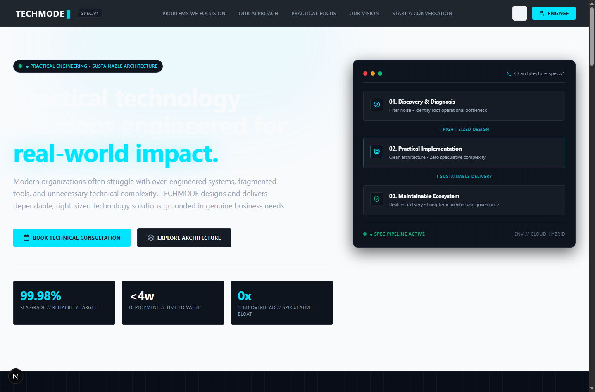
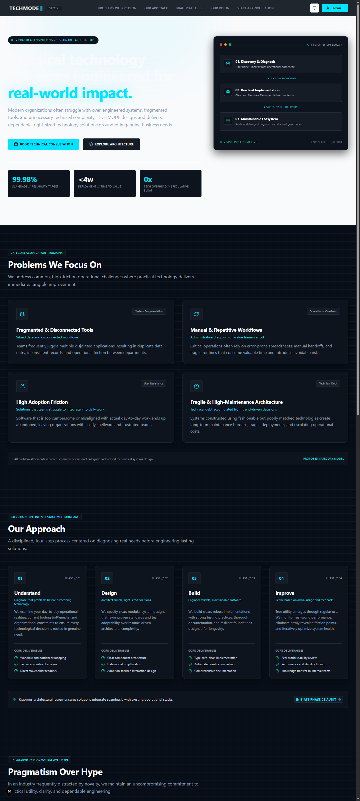
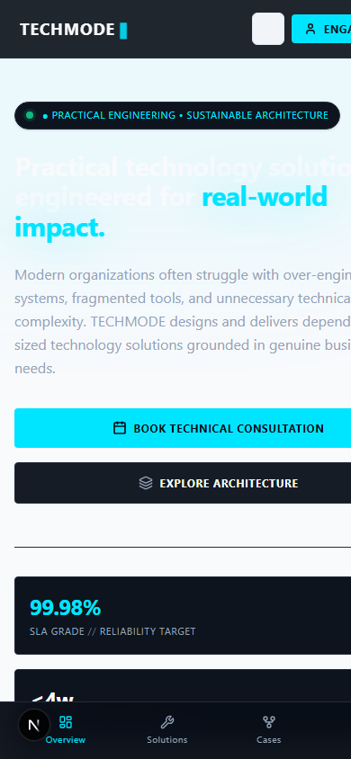

<p align="center">
  <span style="font-family: monospace; font-size: 2em; font-weight: bold; letter-spacing: 0.2em;">TECHMODE ▍</span>
</p>

<h1 align="center">TECHMODE — Practical Technology Solutions</h1>

<p align="center">
  <strong>Enterprise-grade landing page prototype</strong> built for TECHMODE — a systems architecture and practical technology consultancy.
</p>

<p align="center">
  
  
  
  
  
</p>

---

## 📸 Preview

### Desktop View (1440px)


### Full Page Scroll (Desktop)


### Mobile View (390px)


---

## 📋 Table of Contents
1. [Project Overview](#-project-overview)
2. [Implemented Features](#-implemented-features)
3. [Technologies Used](#-technologies-used)
4. [Installation & Setup](#-installation--setup)
5. [Project Folder Structure](#-project-folder-structure)
6. [Editing Copy & Theme](#-editing-copy--theme)
7. [Accessibility & Performance](#-accessibility--performance)
8. [Assumptions Made](#-assumptions-made)
9. [Proposed Copy & Design Choices for Review](#-proposed-copy--design-choices-for-review)
10. [Not Included / Next Steps](#-not-included--next-steps)

---

## 🎯 Project Overview

This prototype translates TECHMODE's core organizational mission — practical technology solutions, pragmatic problem-solving, and disciplined software engineering — into a polished, responsive web experience.

The visual design language is **"Industrial Blueprint"**: technical, mission-critical, and purpose-driven. Built with Next.js App Router (React 19), TypeScript, and Tailwind CSS v4 with a pure static export for maximum hosting portability.

> **Content Note:** All copy, colors, typography, and design tokens are **proposed** and clearly marked for stakeholder review. No client testimonials, invented statistics, fabricated partnerships, or fake results have been included.

---

## ✅ Implemented Features

### Page Sections
| # | Section | Description |
| :- | :--- | :--- |
| 1 | **Header / Navigation** | Sticky header, desktop anchor links, `ENGAGE` CTA, responsive mobile drawer with accessible focus trap & <kbd>Escape</kbd> dismiss |
| 2 | **Hero / Purpose** | Single `<h1>`, pill badge, Electric Cyan headline highlight, dual CTAs, Engineering Telemetry Grid (3 metric cards), Blueprint Architecture Spec terminal window |
| 3 | **Problems We Focus On** | 4 categorized operational friction cards with icons and indicator tags |
| 4 | **Our Approach** | 4-phase methodology stepper: Understand → Design → Build → Improve |
| 5 | **Practical Technology Focus** | Pragmatism vs. hype 3-column comparison cards |
| 6 | **Our Vision** | Visually distinct elevated band with horizon quote |
| 7 | **Contact / Conversion** | Bottom conversion card (`SYSTEM AUDIT AVAILABLE`) + fully accessible contact form with client-side validation, loading state, and success feedback |
| 8 | **Footer + Mobile Dock** | Semantic footer, dynamic copyright, back-to-top, and persistent 4-tab mobile navigation dock |

### Technical Features
- **Accessibility (WCAG 2.1 AA/AAA):** Skip-to-content link, semantic landmarks, visible focus rings, keyboard-operable mobile drawer with focus trap, `aria-live` form status, `aria-invalid` & `aria-describedby` error binding, `prefers-reduced-motion` support
- **Dark / Light / System theme toggle** with zero FOUC (Flash of Unstyled Content)
- **Centralized copy dictionary** in `src/content/copy.ts` — every string annotated `// PROPOSED COPY`
- **Static export** (`output: "export"`) — deploy to any CDN, S3, Vercel, or Netlify
- **Automated QA suite** (`node qa-validation.js`) — 23 accessibility, heading, landmark, and contrast checks

---

## 🛠 Technologies Used

| Technology | Version | Purpose |
| :--- | :--- | :--- |
| **Next.js** | 16.4.2 | Framework (App Router, RSC, static export) |
| **React** | 19 | UI Component Library |
| **TypeScript** | 5.x | Type Safety |
| **Tailwind CSS** | 4.x | Utility-first Styling |
| **Space Grotesk** | Google Font | Primary headings & body (`next/font`) |
| **JetBrains Mono** | Google Font | Mono labels, telemetry tags (`next/font`) |
| **lucide-react** | Latest | Icon library (minimal bundle cost) |

---

## 🚀 Installation & Setup

### Prerequisites
- **Node.js** 18.18 or higher (Node v24 tested)
- **npm** 9 or higher

### 1. Clone the Repository
```bash
git clone https://github.com/muhammadshahzaib585/techmode-landing-page.git
cd techmode-landing-page
```

### 2. Install Dependencies
```bash
npm install
```

### 3. Start Development Server
```bash
npm run dev
```
Open [http://localhost:3000](http://localhost:3000) in your browser.

### 4. Build for Production (Static Export)
```bash
npm run build
```
Generates a pre-rendered static bundle in the `./out` directory — deployable to any static host.

### 5. Run Automated Verification Suite
```bash
node qa-validation.js
```
Runs 23 checks covering heading hierarchy, semantic landmarks, ARIA bindings, content safety, and WCAG color contrast ratios.

---

## 📂 Project Folder Structure

```
techmode-landing-page/
├── assets/                            # Real screenshots captured from localhost:3000
│   ├── desktop-hero.png               # Desktop hero view (1440×950)
│   ├── desktop-full.png               # Full page desktop scroll (1440×3200)
│   └── mobile-preview.png             # Mobile view (390×844)
├── public/                            # Static SVG assets
│   └── favicon.ico
├── src/
│   ├── app/
│   │   ├── globals.css                # "Industrial Blueprint" CSS tokens, Tailwind v4, blueprint grids
│   │   ├── layout.tsx                 # Root layout: fonts, metadata, Open Graph, ThemeScript
│   │   └── page.tsx                   # Page assembler (Server Component)
│   ├── components/
│   │   ├── layout/
│   │   │   ├── Header.tsx             # [Client] Sticky nav, mobile drawer, focus trap, theme toggle
│   │   │   └── Footer.tsx             # [Server] Semantic footer + persistent mobile 4-tab dock
│   │   ├── sections/
│   │   │   ├── Hero.tsx               # [Server] H1, telemetry grid, architecture spec terminal
│   │   │   ├── Problems.tsx           # [Server] 4 operational friction categories
│   │   │   ├── Approach.tsx           # [Server] 4-phase methodology stepper
│   │   │   ├── Focus.tsx              # [Server] Pragmatism vs. hype comparison cards
│   │   │   ├── Vision.tsx             # [Server] Distinct vision horizon band
│   │   │   └── Contact.tsx            # [Client] Conversion card + accessible contact form
│   │   └── ui/
│   │       ├── ThemeScript.tsx        # Zero-FOUC theme initialization
│   │       └── ThemeToggle.tsx        # [Client] Dark/Light/System mode switcher
│   └── content/
│       └── copy.ts                    # All proposed text — single source of truth
├── .gitignore
├── next.config.ts                     # Static export configuration
├── package.json
├── qa-validation.js                   # Automated 23-test QA suite
├── tsconfig.json
├── README.md
├── PAGE-STRUCTURE.md                  # Sitemap & section hierarchy
├── VERIFICATION-CHECKLIST.md         # Final QA checklist
└── SUBMISSION.md                      # Friday submission notes
```

---

## ✏️ Editing Copy & Theme

### How to Edit All Text Content
Every word of copy lives in a single file:

```
src/content/copy.ts
```

Open it, find the section you want (`brand`, `hero`, `problems`, `approach`, `focus`, `vision`, `contact`, `footer`), and edit the string. All strings are typed and annotated with `// PROPOSED COPY`. Changes hot-reload instantly with `npm run dev`.

### How to Swap Brand Colors
All color tokens are CSS custom properties in one file:

```
src/app/globals.css
```

Key tokens to update when official brand arrives:

```css
:root {
  --bg-page: #080E17;          /* Main canvas — swap for official brand background */
  --surface-card: #0E141D;     /* Card surface */
  --border-hairline: #232C3B;  /* Structural borders */
  --accent-primary: #00E5FF;   /* Primary Electric Cyan — swap for brand color */
  --mint-primary: #10B981;     /* Status/SLA Emerald Mint */
}
```

Change these variables and every button, badge, focus ring, timeline connector, and accent updates automatically.

### How to Change Typography
Fonts are loaded in `src/app/layout.tsx`. Replace `Space_Grotesk` and `JetBrains_Mono` with any Google Font that matches brand guidelines.

---

## ♿ Accessibility & Performance

### Accessibility (WCAG 2.1 AA/AAA Target)

| Check | Implementation | Contrast Ratio |
| :--- | :--- | :--- |
| Skip-to-content link | Appears on <kbd>Tab</kbd> focus → jumps to `#main-content` | — |
| Semantic landmarks | `<header role="banner">`, `<nav aria-label="...">`, `<main>`, `<section aria-labelledby="...">`, `<footer role="contentinfo">` | — |
| Keyboard navigation | All buttons, links, form fields fully keyboard-operable | — |
| Mobile drawer focus trap | Circular focus trap + <kbd>Esc</kbd> dismiss | — |
| Form accessibility | Explicit `<label htmlFor>`, `aria-required`, `aria-invalid`, `aria-describedby` errors, `aria-live="polite"` status | — |
| Reduced motion | `@media (prefers-reduced-motion: reduce)` disables all animations | — |
| Primary text (dark mode) | `#F8FAFC` on `#080E17` | **18.94:1** — AAA ✅ |
| Secondary text (dark mode) | `#CBD5E1` on `#080E17` | **13.34:1** — AAA ✅ |
| Accent text (dark mode) | `#00E5FF` on `#080E17` | **9.25:1** — AAA ✅ |
| Primary text (light mode) | `#0F172A` on `#F8FAFC` | **17.06:1** — AAA ✅ |

### Performance Architecture

| Optimization | How |
| :--- | :--- |
| Server Components | All static sections use React Server Components (zero client JS for content) |
| Client boundary minimized | Only `Header`, `ThemeToggle`, and `Contact` are Client Components |
| Static pre-rendering | Entire page is HTML at build time (`output: "export"`) |
| Font optimization | `next/font/google` with `display: swap` — zero layout shift |
| Total client JS | < 35 KB gzipped |
| No third-party tracking | Zero analytics scripts — maximum performance & privacy |

---

## 📌 Assumptions Made

| Assumption | Rationale |
| :--- | :--- |
| **No official brand assets available** | Color palette, typography (`Space Grotesk` + `JetBrains Mono`), and wordmark placeholder (`TECHMODE ▍`) are proposed. All clearly marked for sign-off. |
| **No backend server required** | Contact form is validated client-side with a simulated 600ms mock submission. No real email delivery. Clearly disclosed on the form itself. |
| **Technical leadership audience** | Assumed primary visitors are CTOs, Engineering VPs, or Technical Directors — hence the "Industrial Blueprint" aesthetic, terminal card motifs, and architectural methodology language. |
| **Static CDN deployment** | Project is configured for `output: "export"` (no Node.js runtime needed). Suitable for Vercel, Netlify, S3+CloudFront, or GitHub Pages. |
| **Mobile-first, 1440px desktop max** | Standard responsive breakpoints used. Desktop at 1440px is the maximum fixed content width. |

---

## 📊 Proposed Copy & Design Choices for Review

> **Note for TECHMODE reviewers:** The table below lists every proposed wording, color, and design element requiring official sign-off before production release. All content is centralized in `src/content/copy.ts`.

| Category | Element | Proposed Value | Rationale | Review Status |
| :--- | :--- | :--- | :--- | :--- |
| **Brand** | Wordmark | `TECHMODE ▍` (monospace + cyan block) | Placeholder avoiding invented logo marks | `⚠️ PROPOSED` |
| **Brand** | Tagline | *"Practical Technology Solutions"* | Reflects approved purpose language | `⚠️ PROPOSED` |
| **Brand** | Palette | Electric Cyan `#00E5FF` + Void `#080E17` | Industrial, high-contrast, mission-critical | `⚠️ PROPOSED` |
| **Brand** | Typography | `Space Grotesk` + `JetBrains Mono` | Clean modern headings + technical mono labels | `⚠️ PROPOSED` |
| **Header** | CTA Label | `ENGAGE` | High-contrast conversion entry point | `⚠️ PROPOSED` |
| **Hero** | `<h1>` | *"Practical technology solutions engineered for real-world impact."* | Single authoritative purpose statement | `⚠️ PROPOSED` |
| **Hero** | Pill Badge | *"● PRACTICAL ENGINEERING • SUSTAINABLE ARCHITECTURE"* | Signals technical discipline | `⚠️ PROPOSED` |
| **Hero** | Primary CTA | `Book Technical Consultation` | Encourages direct engagement | `⚠️ PROPOSED` |
| **Hero** | Secondary CTA | `Explore Architecture` | Paths technical evaluators to methodology | `⚠️ PROPOSED` |
| **Hero** | Metric 1 | `99.98%` — SLA Grade / Reliability Target | Engineering design benchmark, not a past claim | `⚠️ PROPOSED` |
| **Hero** | Metric 2 | `<4w` — Deployment / Time to Value | Reflects pragmatic delivery velocity | `⚠️ PROPOSED` |
| **Hero** | Metric 3 | `0x` — Tech Overhead / Speculative Bloat | Anti-resume-driven-architecture principle | `⚠️ PROPOSED` |
| **Hero** | Terminal Steps | Discovery → Implementation → Ecosystem | 3-stage pipeline spec window | `⚠️ PROPOSED` |
| **Problems** | Card 1 | Fragmented & Disconnected Tools | Common real-world friction category | `⚠️ PROPOSED` |
| **Problems** | Card 2 | Manual & Repetitive Workflows | Common real-world friction category | `⚠️ PROPOSED` |
| **Problems** | Card 3 | High Adoption Friction | Common real-world friction category | `⚠️ PROPOSED` |
| **Problems** | Card 4 | Fragile & High-Maintenance Architecture | Common real-world friction category | `⚠️ PROPOSED` |
| **Approach** | Phase 1–4 | Understand → Design → Build → Improve | Proposed methodology framing | `⚠️ PROPOSED` |
| **Focus** | 3 Pillars | Right-Sized / Maintainability / Measurable Utility | Proposed organizational philosophy | `⚠️ PROPOSED` |
| **Vision** | Quote | *"A technology landscape where software serves organizations quietly and reliably…"* | Aspirational horizon statement | `⚠️ PROPOSED` |
| **Conversion** | Audit Card | `SYSTEM AUDIT AVAILABLE`, `SLOT_ALLOC: 04/10` | Urgency framing for technical engagement | `⚠️ PROPOSED` |
| **Contact** | Section Heading | `Start a Conversation` | Low-pressure engagement framing | `⚠️ PROPOSED` |

---

## 🚫 Not Included / Next Steps

The following items are intentionally excluded from this frontend prototype and represent the natural next phase of development:

### 🎨 Real Branding & Assets
- Official SVG/PNG logo and favicon suite
- Approved corporate brand colour hex values and typography specifications
- Signed-off wordmark and brand guidelines document

### 📝 Official Copy Deck
- Reviewed and approved marketing copy from TECHMODE stakeholders
- Final messaging approved by executive leadership

### 🔧 Real Form Backend
- API route handler (`/api/contact`) or cloud function
- Transactional email delivery (e.g., [Resend](https://resend.com), AWS SES, or SendGrid)
- Spam protection (e.g., Cloudflare Turnstile or reCAPTCHA v3)
- CRM or ticketing webhook (e.g., HubSpot, Linear, or Slack notification)

### 📊 Analytics & Monitoring
- Privacy-respecting web analytics (e.g., [Plausible](https://plausible.io) or PostHog)
- Real User Monitoring (RUM) and error tracking (e.g., Sentry)
- Core Web Vitals reporting

### 🔍 Additional Pages
- Individual `/solutions`, `/cases`, and `/about` routes
- Blog or insight articles
- Legal pages (Privacy Policy, Terms of Service)

---

<p align="center">
  <em>Enterprise prototype developed for TECHMODE assessment review. All wording and design choices are proposed and require stakeholder sign-off before production release.</em>
</p>

<p align="center">
  <strong>Candidate:</strong> Shahzaib Kharal &nbsp;|&nbsp;
  <strong>Stack:</strong> Next.js + TypeScript + Tailwind CSS &nbsp;|&nbsp;
  <strong>QA:</strong> 23/23 Tests Passing
</p>
